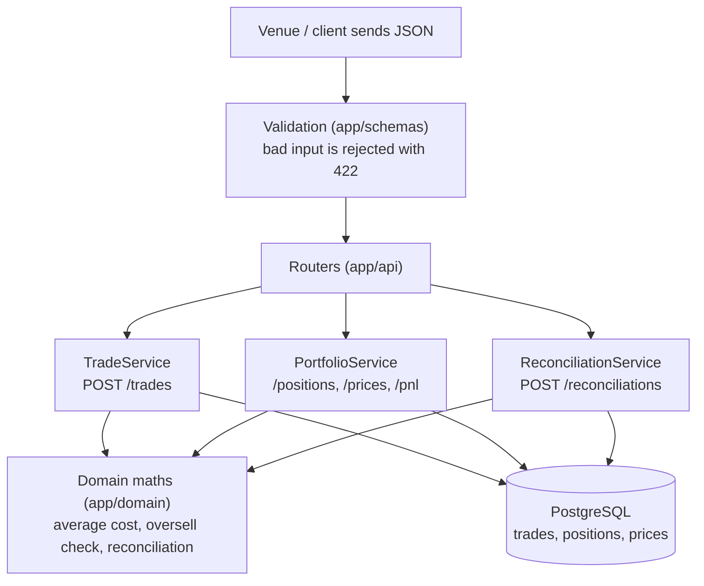
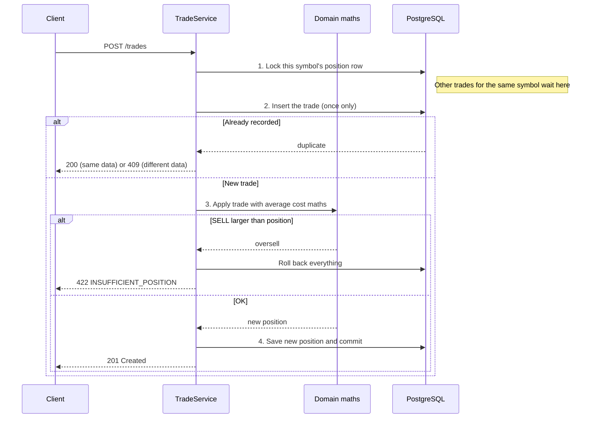

# Design

**Goal:** the books are never wrong. That means no trade counted twice, no negative
position, no rounding errors, even when requests arrive at the same moment.

## Architecture

### How a request flows

Input is validated first, so bad data never reaches the database. A router hands the
request to the service for that feature. The service runs the database work and calls the
domain code for the maths. The domain code is pure Python with no database or HTTP code,
so it is simple and fast to test.

### Recording a trade, step by step

`POST /trades` runs as **one transaction**. Read top to bottom:

The order matters. The lock comes first, so two SELLs can't both read the old quantity
and both pass the check. The insert comes before the maths, so a resent trade is caught
before it can change the position.

| Table | Purpose |
|---|---|
| `trades` | Every trade ever received; rows are never changed. **The source of truth.** |
| `positions` | Running total per symbol: quantity, cost basis, realized PnL. Can be rebuilt from `trades`. |
| `prices` | Latest price per symbol, for unrealized PnL. |

## Key decisions

**1. Cost basis: average cost.**
A BUY updates the average price. A SELL locks in `(sell price - average) x quantity` as
realized PnL and leaves the average unchanged. For the worked example (BUY 10 @ 100,
BUY 10 @ 110, SELL 5 @ 120, price 125) this gives quantity 15, average cost 105, realized
PnL 75 and unrealized PnL 300.

Why average cost and not FIFO:

* **Simple and fast.** A position is just three numbers (quantity, total cost, realized
  PnL), updated in the same transaction as the trade. FIFO has to keep a list of every
  open purchase lot and walk through it on each SELL.
* **Fits a shared position.** A position is combined across venues, so there is no
  natural answer to "which coin was sold": BTC bought on Binance and sold on Coinbase is
  one holding. Average cost treats the holding as a whole.
* **Easy for traders and operations staff to verify.** When someone questions a PnL
  number, they can recompute it by hand: the average price only changes on a BUY, so
  realized PnL is just `(sell price - average price) x quantity sold`. With FIFO they
  would first have to work out which earlier purchases each SELL used up.

**2. Idempotency: a unique key on `(venue, trade_id)`.**
Trades are inserted with `INSERT ... ON CONFLICT DO NOTHING`, so PostgreSQL guarantees one
row even if two identical requests arrive together. A repeat with the **same** data returns
`200` (nothing changes). A repeat with **different** data returns `409`: recorded trades
are never overwritten.

**3. Oversell protection: lock the symbol's position row.**
Every trade runs in one transaction:

1. Lock the position row (`SELECT ... FOR UPDATE`).
2. Insert the trade.
3. Check the SELL is not larger than the position.
4. Update the position, then commit.

The lock makes other trades for the **same symbol** wait their turn, so two SELLs can't
both pass the check. Other symbols are not blocked. On oversell the API returns
`422 INSUFFICIENT_POSITION` and the whole transaction rolls back: neither the trade nor the
position changes. A database rule (`quantity >= 0`) is a second safety net.

**4. Money is always Decimal.**
Columns are `NUMERIC(38,18)`, and Python uses `Decimal` with 80 digits of precision
(Python's default of 28 digits can round large crypto values). Amounts must be sent as
strings like `"100.5"`; JSON numbers are rejected because they can already be imprecise.

**5. Reconciliation only reports.**
`POST /reconciliations/{venue}` matches a venue statement to our trades by `trade_id` and
returns **missing** (on the statement, not with us), **extra** (with us, not on the
statement) and **mismatched** (different values, field by field). It never edits data,
because the venue is not always the side that is wrong.

## Assumptions

Design choices taken where the requirements leave a decision open, and the reasons for
each.

**1. One position per symbol, across all venues.**
Buying 4 BTC on Binance and 6 BTC on Coinbase gives one BTC-USD position of 10, not two
positions of 4 and 6. Positions are required "per symbol", and a firm's real
exposure is its total holding wherever it was bought. Selling on any venue reduces that
one position.

**2. Long only: no short selling.**
You can only sell what you already hold. A SELL larger than the position is rejected
(the oversell rule), so a position is never negative.

**3. Trades are applied in the order they arrive.**
Sometimes a trade arrives late, with a timestamp older than trades already recorded. It is
applied when it arrives rather than slotted back into timestamp order. Re-ordering could
make a SELL that was valid when it was accepted retroactively become an oversell, which
would leave the books in a state the system already promised could not happen.

**4. Inputs are stored in one standard form.**
`"Binance"` and `"binance"` are the same venue, so venues are stored in lowercase.
Symbols are stored in uppercase (`"btc-usd"` becomes `"BTC-USD"`). Timestamps must
include a timezone, because `10:00` alone is ambiguous, and they are stored in UTC.

**5. PnL is totalled per quote currency.**
Profit on `BTC-USD` is in US dollars, while profit on `ETH-BTC` is in bitcoin. Adding the two
would be like adding rupees to dollars, so totals are reported separately for each quote
currency.

**6. Fees are not included.**
The required trade format has no fee field, so PnL is calculated without fees. Fees
could be added later as an extra field that reduces realized PnL.

## Testing

* **Unit tests:** the worked example, oversell, rounding and
  reconciliation, with no database.
* **Integration tests:** against real PostgreSQL, including races: 15 identical trades at
  once save 1 row, and 10 SELLs racing against a position of 10 let exactly 3 through.
* `scripts/demo.py` shows every requirement against the running API.
